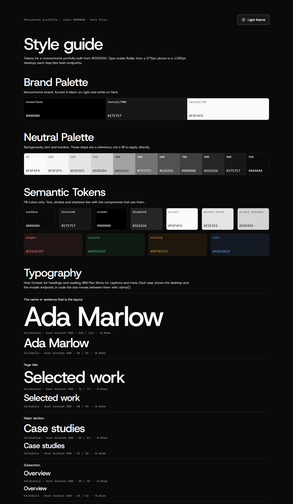
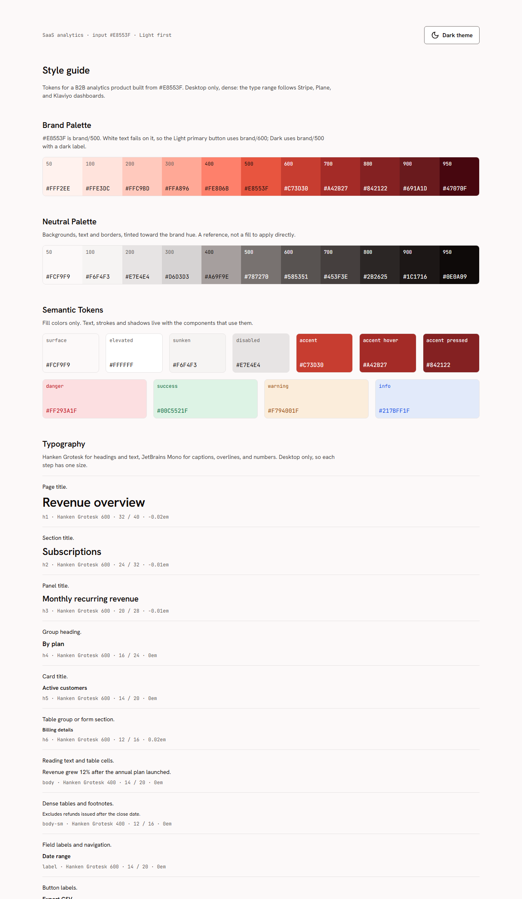

# design-skills

Agent skills for UX/UI designers who work with LLMs. They run in **Claude Code**, **Cursor**, and **ChatGPT** from the same files.

| Skill | What it does |
|---|---|
| [`style-guide`](style-guide/SKILL.md) | Turns one brand color and a site type into a full token system, a style guide page, base components, and a `DESIGN.md` that tells any LLM how to build with them. Writes to Figma or to code. |

More skills (page design from the style guide, client brief) are on the way.



## style-guide

Type `/style-guide` and answer four short questions in chat, in any language:

1. **Color and site type**, for example `#1DBF73 portfolio` or `#000000 portfolio`.
2. **Description** (optional). Fonts, a spacing scale, a radius, or "light only" written here are treated as constraints.
3. **Links** to sites you like (optional). Used for mood only.
4. **Screens**: `desktop`, `mobile`, or both.

The skill then researches the site type (Mobbin when it is connected, the web otherwise), posts a proposal with every number and where it came from, and asks where to put the result: `figma` or `code`. Nothing is written before you answer.

### What you get

- **Tokens in three layers.** Primitives, semantic roles in Light and Dark, and component tokens. Every token has a job description and a scope.
- **A palette from one color.** OKLCH ramps for brand and neutral. White, black, and gray inputs become a deliberate monochrome system; very light and very dark colors land on the right step instead of being forced to `500`.
- **Contrast that is checked, not hoped for.** Muted text 4.5:1 on every surface, field borders and focus rings 3:1, status text 4.5:1 on its own tint. A step that fails is replaced and the proposal says so.
- **Type from research.** Font pairs chosen from what real sites of that type use, never the defaults every generated site reaches for. Sizes snap to a 4px grid, with tracking per step and fluid `clamp()` sizes in code.
- **Base components with every state.** Button (primary, secondary, ghost × default, hover, pressed, focus, disabled, loading), text field, card, badge, and Lucide icons at 16, 20, and 24.
- **The same page every run.** The style guide page is built from a fixed template; only the tokens change.
- **`DESIGN.md`.** Rules for whoever builds next, person or LLM: link `tokens.css`, use only tokens and components, and avoid the patterns people now read as AI-made (purple gradients, glowing colored shadows, emoji icons, the centered-hero-plus-three-cards layout).

### Output

| Target | Files |
|---|---|
| `figma` | Variable collections, text and effect styles, a **Style guide** page, a **Components** page, plus `DESIGN.md` |
| `code` | `tokens.css`, `style-guide.html` (opens by double-click, theme switch included), `DESIGN.md` |

### Examples

| | |
|---|---|
| [Monochrome portfolio](examples/monochrome-portfolio/) · `#000000`, portfolio, desktop and mobile, Dark first | [SaaS analytics](examples/saas-coral/) · `#E8553F`, saas, desktop only, Light first |
|  |  |

Open any `style-guide.html` from a local server or by double-click; it reads `tokens.css` next to it. The SaaS example includes the contrast report from its run.

## Install

### Claude Code

Copy the skill folder into your skills directory:

```bash
git clone https://github.com/sekretmaksym-dev/design-skills
cp -r design-skills/style-guide ~/.claude/skills/
```

Use `.claude/skills/` inside a project instead to install it for that project only. Start a new session and type `/style-guide`.

### Cursor

```bash
cp -r design-skills/style-guide ~/.cursor/skills/
```

### ChatGPT

Download [`dist/style-guide.zip`](dist/style-guide.zip) and upload it in ChatGPT under **Skills → Create → Upload from your computer**. Then ask for a style guide. ChatGPT has no Figma write access by default, so it offers the `code` output and gives you the files to download.

### Other agents

The skill is a plain `SKILL.md` folder (the [Agent Skills](https://agentskills.io) format). Any agent that reads that format can use it; Codex looks in `.agents/skills/`.

## Requirements

- **Figma output:** the [Figma MCP server](https://github.com/figma/mcp-server-guide) (`https://mcp.figma.com/mcp`) and Figma's `figma-use` skill, which ships with the official Figma plugin for Claude Code and Cursor. Without them the skill offers `code` only.
- **Mobbin research (optional):** the Mobbin connector. Without it the skill researches with web search.
- **Dark mode in Figma** needs a Figma plan that allows more than one variable mode.

## Status

- `code` output: tested end to end in Claude Code on both examples above, in both themes.
- `figma` output: built and used in Cursor. Not yet tested in Claude Code.
- ChatGPT: packaged; not yet tested.

Issues and pull requests are welcome.

## Repository layout

```
style-guide/
  SKILL.md                    the skill
  reference.md                token tables, page recipes, component specs
  design-rules.md             template for the DESIGN.md it writes
  style-guide.template.html   fixed page template for code output
examples/                     two finished systems
dist/style-guide.zip          ChatGPT upload
sync.ps1                      maintainer script: copies skills to Claude Code and Cursor, rebuilds the zip
```

## Credits

- Icons: [Lucide](https://lucide.dev) (ISC).
- Fonts in the examples: Host Grotesk, IBM Plex Mono, Hanken Grotesk, JetBrains Mono, all from Google Fonts under the SIL Open Font License.
- Research screenshots and references come from [Mobbin](https://mobbin.com); no images from it are included here.

## License

[MIT](LICENSE) © 2026 Maksym Sekret
